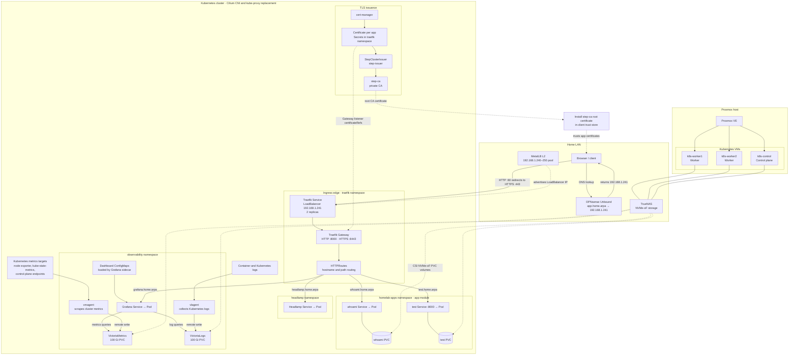

# Homelab infrastructure

## Request and data paths

- Clients resolve each `*.home.arpa` app name through OPNsense to the Traefik LoadBalancer IP.
- Traefik redirects HTTP to HTTPS. The Gateway selects a certificate and HTTPRoute, then sends traffic to the app Service.
- cert-manager requests an individual certificate through the StepClusterIssuer and step-ca. The resulting Secrets are referenced by the Traefik Gateway listener.
- vmagent scrapes cluster metrics and writes them to VictoriaMetrics; vlagent collects Kubernetes logs and writes them to VictoriaLogs. Grafana queries both stores and loads dashboards from ConfigMaps.
- Proxmox runs one control-plane VM and two worker VMs. Cilium provides cluster networking and replaces kube-proxy. TrueNAS supplies persistent volumes through its NVMe-oF CSI driver.
